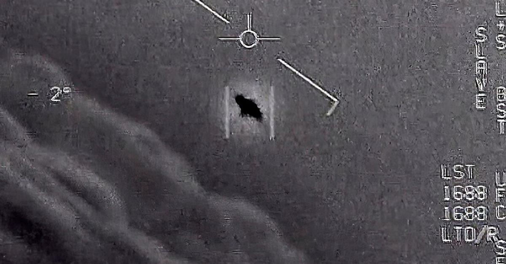

[](https://doi.org/10.5281/zenodo.19138270)

# Reverse Engineering the Dynamics of UFOs

**UFO 動力學之逆向工程**

*— A Physics-Based Assessment of Unidentified Aerial Phenomena*



*Banner image: publicly released UAP footage still used here as contextual illustration.*

*Banner 圖片：公開釋出之 UAP 影像截圖，於此作為情境性視覺說明使用。*

---

## Author / 作者

**Kris Lai**
- Email: kriss@scallop.io
- ORCID: [0009-0000-2223-4826](https://orcid.org/0009-0000-2223-4826)
- Affiliation: [Scallop Labs](https://www.scallop.io/)

## Contributors / 貢獻者

- **Andrei Tihoc** — andrewt@scallop.io

---

## Documents / 文件

| Document | Language | Description |
|----------|----------|-------------|
| [`docs/en/full-text.md`](https://github.com/djchrisssssss/ufo-dynamics-reverse-engineering/blob/master/docs/en/full-text.md) | English | Full assessment in Markdown |
| [`docs/zh-TW/full-text.md`](https://github.com/djchrisssssss/ufo-dynamics-reverse-engineering/blob/master/docs/zh-TW/full-text.md) | 繁體中文 | 完整評估報告 |
| [`docs/en/verification-report.md`](https://github.com/djchrisssssss/ufo-dynamics-reverse-engineering/blob/master/docs/en/verification-report.md) | English | Data verification report |
| [`docs/zh-TW/verification-report.md`](https://github.com/djchrisssssss/ufo-dynamics-reverse-engineering/blob/master/docs/zh-TW/verification-report.md) | 繁體中文 | 資料驗證報告 |
| [`latex/main.tex`](https://github.com/djchrisssssss/ufo-dynamics-reverse-engineering/blob/master/latex/main.tex) | English | REVTeX 4-2 academic paper |

---

## Abstract / 摘要

A source-critical physics assessment of reported UFO/UAP flight characteristics. It evaluates whether candidate mechanisms — including Alcubierre warp metrics, nuclear fusion, quantum-field effects, and metamaterials — are quantitatively compatible with the "Five Observables" taxonomy. Public UAP data are generally too poorly calibrated to establish the claimed kinematics, and mathematically valid warp metrics are not known to be physically realizable. The central unresolved problem is realizing and controlling the required stress-energy distribution, not a separate conversion of energy into curvature.

以來源批判與物理量化為基礎，評估已報告之 UFO/UAP 飛行特徵，以及阿乎庫比耶曲速度規、核融合、量子場效應與超穎材料等候選機制。公開 UAP 資料通常缺乏足以建立所稱運動學之校準與中介資料；數學上成立之曲速度規亦不等於物理上可實現。核心未解問題是如何實現並控制所需之應力—能量分布，而非另有一個「能量轉換成曲率」之交互作用。

> This is an independent scientific assessment. No classified information was used. All sources are publicly available, except one unpublished author-compiled narrative summary used only as phenomenological input in Section 9.7–9.10.

---

## Background / 背景

This work was prompted by a close reading of ***Imminent: Inside the Pentagon's Hunt for UFOs*** (William Morrow, 2024) by **Luis Elizondo**. The memoir is a secondary, participant account and is used here as a source of hypotheses rather than as validation of physical observations. AARO distinguishes the official 2009–2012 AAWSAP contract from a later informal use of the AATIP label and reports that the exploratory DIRDs were not thoroughly peer reviewed.

Claims such as instantaneous acceleration, transmedium travel, and absence of sonic booms can be translated into testable physical quantities, but the public evidence does not establish that every claimed observable occurred as described. This assessment therefore treats the Five Observables and the DIRDs as prompts for conditional analysis, separates source-dependent estimates from measurements, and asks what additional calibrated data would be required before any propulsion inference is justified.

本作品起因於對 **Luis Elizondo** 所著 ***《Imminent: Inside the Pentagon's Hunt for UFOs》***（William Morrow, 2024）的深入研讀。該書為參與者之回憶錄，屬次級來源，本文僅將其作為假說來源，而非物理觀測之驗證。AARO 區分 2009–2012 年之官方 AAWSAP 合約與其後非正式使用之 AATIP 名稱，並指出探索性 DIRD 未經完整同儕審查。

瞬間加速、跨介質飛行與無音爆等主張可轉換為可檢驗之物理量，但公開證據並未確立每項所稱之可觀測特徵確如描述般發生。因此本評估將五大可觀測特徵與 DIRD 視為條件式分析之起點，區分來源相依之估計與量測，並探討在任何推進推論成立之前，還需要哪些經校準之資料。

---

## Sections / 章節概覽

| # | Section | 節標題 | Key Topics |
|---|---------|--------|------------|
| 1 | Introduction & Historical Context | 導論與歷史脈絡 | Terminology (UFO ⊂ UAP); Blue Book → AATIP → AARO; 38 DIRDs |
| 2 | Observable Characteristics | 可觀測特徵 | Five Observables; data quality assessment; geodesic equation; equivalence principle; alternative frameworks |
| 3 | Propulsion Mechanisms | 推進機制 | Alcubierre metric; ray-tracing requirements; exotic matter; wormholes |
| 4 | Energy Sources | 能量來源 | DT/DD fusion; NIF ignition; heavy water; vacuum energy |
| 5 | Electromagnetic Signatures | 電磁特徵 | Dynamical Casimir; Unruh; Hawking; THz gap; biological effects |
| 6 | Advanced Materials | 先進材料 | Metamaterials; CNT; graphene; AARO/ORNL specimen; subatomic bonding claims |
| 7 | Integrated Model | 整合模型 | Requirements map; constraint classification |
| 8 | Intelligence Gaps | 情報缺口 | Research priorities; definitive evidence criteria |
| 9 | Mathematical Foundations | 數學與相對論基礎 | Proper acceleration; oblate shell geometry; tidal and EM constraints |
| A–E | Appendices | 附錄 | Glossary; equations; DIRD list; confidence definitions; falsification criteria |

---

## Data & References / 資料與參考文獻

| Directory | Contents | 內容 |
|-----------|----------|------|
| `data/schemas/` | JSON Schema for statistics validation | 資料驗證 Schema |
| `data/statistics/` | Per-section quantitative data (45 data points) | 各節定量資料 |
| `data/timelines/` | UAP investigation history; DIRD catalog (CSV) | 調查歷程時間軸 |
| `data/comparisons/` | Energy density; materials gap analysis (CSV) | 能量密度與材料差距比較 |
| `references/bibliography.json` | Master bibliography (71 sources) | 主參考書目 |
| `references/source-registry.json` | URL verification registry (34 URLs) | URL 驗證登錄 |
| `references/note-map.json` | Canonical note-to-source map (`ref-*` / `KJ-*` -> `src-*` + auxiliary IDs) | canonical 註記與來源對照表 |
| `references/per-section/` | Per-section reference documentation | 各節參考文獻 |

## How to Trace Citations / 如何查找引用

The maintained Markdown documents use stable inline note IDs such as `[ref-058]` and `[KJ-3]`. These labels are note identifiers, not bibliography item numbers.

已維護的 Markdown 文件使用穩定的行內註記 ID，例如 `[ref-058]` 與 `[KJ-3]`。這些標記是註記識別碼，不是文末書目編號。

To trace a citation back to the original source:

若要從正文追到原始來源，請依照以下路徑：

1. Start from the canonical reading version: [`docs/en/full-text.md`](https://github.com/djchrisssssss/ufo-dynamics-reverse-engineering/blob/master/docs/en/full-text.md) or [`docs/zh-TW/full-text.md`](https://github.com/djchrisssssss/ufo-dynamics-reverse-engineering/blob/master/docs/zh-TW/full-text.md).
2. Open [`references/note-map.json`](https://github.com/djchrisssssss/ufo-dynamics-reverse-engineering/blob/master/references/note-map.json) to map the note ID directly to one or more `src-*` entries and any auxiliary source IDs.
3. Identify the section where the note appears, then open the matching file under `references/per-section/` such as `s03-references.md`.
4. Use that per-section file to read the corresponding `[src-xxx]` source entry in human-readable form.
5. If you need the underlying citation record, check [`latex/main.tex`](https://github.com/djchrisssssss/ufo-dynamics-reverse-engineering/blob/master/latex/main.tex) for the original `\cite{...}` key and [`latex/references.bib`](https://github.com/djchrisssssss/ufo-dynamics-reverse-engineering/blob/master/latex/references.bib) for the full BibTeX entry.

1. 從 canonical 閱讀版本開始：[`docs/en/full-text.md`](https://github.com/djchrisssssss/ufo-dynamics-reverse-engineering/blob/master/docs/en/full-text.md) 或 [`docs/zh-TW/full-text.md`](https://github.com/djchrisssssss/ufo-dynamics-reverse-engineering/blob/master/docs/zh-TW/full-text.md)。
2. 先打開 [`references/note-map.json`](https://github.com/djchrisssssss/ufo-dynamics-reverse-engineering/blob/master/references/note-map.json)，把註記 ID 直接對到一個或多個 `src-*` 以及必要的輔助來源 ID。
3. 再判斷該註記出現在第幾節，打開 `references/per-section/` 下對應的檔案，例如 `s03-references.md`。
4. 在該節 reference 檔中閱讀對應的 `[src-xxx]` 來源條目。
5. 如果需要更底層的引用資訊，再到 [`latex/main.tex`](https://github.com/djchrisssssss/ufo-dynamics-reverse-engineering/blob/master/latex/main.tex) 看原始 `\cite{...}` key，並到 [`latex/references.bib`](https://github.com/djchrisssssss/ufo-dynamics-reverse-engineering/blob/master/latex/references.bib) 看完整 BibTeX。

Example:

範例：

- `[ref-058]` appears in Section 3.4 on the Casimir effect.
- Its section reference file is [`references/per-section/s03-references.md`](https://github.com/djchrisssssss/ufo-dynamics-reverse-engineering/blob/master/references/per-section/s03-references.md).
- In that file, the relevant source is `[src-014] Casimir, H.B.G. (1948)`.
- The original LaTeX citation key is `Casimir1948`, and the full entry appears in [`latex/references.bib`](https://github.com/djchrisssssss/ufo-dynamics-reverse-engineering/blob/master/latex/references.bib).

- `[ref-058]` 出現在第 3.4 節的卡西米爾效應段落。
- 它對應的分節 reference 檔是 [`references/per-section/s03-references.md`](https://github.com/djchrisssssss/ufo-dynamics-reverse-engineering/blob/master/references/per-section/s03-references.md)。
- 在該檔案中，可找到相關來源為 `[src-014] Casimir, H.B.G. (1948)`。
- 其原始 LaTeX citation key 是 `Casimir1948`，完整條目則位於 [`latex/references.bib`](https://github.com/djchrisssssss/ufo-dynamics-reverse-engineering/blob/master/latex/references.bib)。

### Source Breakdown / 來源分布

| Type / 類型 | Count | % |
|-------------|-------|---|
| Peer-reviewed / 同儕審查 | 42 | 59.2% |
| Government / 政府文件 | 9 | 12.7% |
| DIRD / 國防情報參考文件 | 12 | 16.9% |
| Books / 學術專書 | 7 | 9.9% |
| Preprints / 預印本 | 1 | 1.4% |

### Key Government Sources / 主要政府來源

- [ODNI Preliminary Assessment (2021)](https://www.dni.gov/files/ODNI/documents/assessments/Prelimary-Assessment-UAP-20210625.pdf)
- [ODNI 2022 Annual Report](https://www.dni.gov/files/ODNI/documents/assessments/Unclassified-2022-Annual-Report-UAP.pdf)
- [AARO Historical Record Vol I (2024)](https://media.defense.gov/2024/Mar/08/2003409233/-1/-1/0/DOPSR-2024-0175-HISTORICAL-RECORD-REPORT-VOLUME-I-2024.PDF)
- [ICD 203 Analytic Standards](https://www.dni.gov/files/documents/ICD/ICD-203.pdf)
- [DIRD Collection (Black Vault FOIA)](https://documents2.theblackvault.com/documents/dia/AAWSAP-DIRDs/)
- [DIRD Master List (FAS)](https://irp.fas.org/dia/aatip-list.pdf)

---

## LaTeX Paper / 學術論文

The assessment is also available as a two-column academic paper formatted with REVTeX 4-2 (APS Physical Review D style):

```bash
cd latex/
pdflatex main.tex && bibtex main && pdflatex main.tex && pdflatex main.tex
```

Compiled PDFs are published through the GitHub Actions `ufo-dynamics-paper` artifact rather than committed to the repository, preventing stale binary snapshots.

已編譯 PDF 由 GitHub Actions 的 `ufo-dynamics-paper` artifact 提供，不再直接提交到 repo，以避免過期的二進位檔案。

---

## Validation / 驗證

```bash
python3 -m pip install -r requirements.txt
python3 -m unittest discover -s tests
python3 scripts/validate_repository.py
python3 scripts/validate_repository.py --check-urls --enforce-url-status   # weekly url-audit.yml
```

The validation script checks bibliography counts, source-registry metadata, statistics-schema compliance, note-map and bilingual note parity, and BibTeX/bibliography agreement. The required CI job (`validate.yml`) runs the unit tests and the offline checks only; live HTTP spot checks run separately in the weekly `url-audit.yml` workflow.

驗證腳本會檢查書目計數、來源註冊 metadata、統計資料 schema 相容性、註記對照表與雙語註記一致性，以及 BibTeX 與書目之一致性。必要的 CI 工作（`validate.yml`）只執行單元測試與離線檢查；即時 HTTP 抽查另由每週執行的 `url-audit.yml` 工作流程負責。

---

## Project Structure / 專案結構

```text
UFO-dynamics-reverse-engineering/
├── docs/
│   ├── en/                          # English documents
│   │   ├── full-text.md
│   │   └── verification-report.md
│   └── zh-TW/                      # Traditional Chinese documents
│       ├── full-text.md
│       ├── transcription.md
│       └── verification-report.md
├── data/
│   ├── schemas/                     # JSON Schema validation
│   ├── statistics/                  # Per-section data (5 JSON files; 45 data points)
│   ├── timelines/                   # Historical events (2 CSVs)
│   └── comparisons/                 # Cross-domain analysis (2 CSVs)
├── references/
│   ├── bibliography.json            # 71 sources
│   ├── source-registry.json         # URL verification
│   ├── note-map.json                # ref-*/KJ-* → src-* + auxiliary IDs
│   └── per-section/                 # 9 reference files
├── latex/
│   ├── main.tex                     # REVTeX 4-2 paper
│   ├── references.bib               # 71 BibTeX entries
│   └── figures/
├── scripts/validate_repository.py   # Repository validator
├── tests/test_validate_repository.py
├── assets/                          # README banner image
├── .github/workflows/               # validate.yml (required), url-audit.yml (weekly)
├── requirements.txt
├── transcription.md                 # Mirror of docs/zh-TW/transcription.md
├── .zenodo.json
├── CLAUDE.md
├── CITATION.cff
├── CHANGELOG.md
└── README.md
```

---

## AI Collaboration & Data Verification / AI 協作與資料驗證

This project was produced through a structured collaboration between the human author and multiple AI systems, including **Claude** (Anthropic), **Codex**, and **GPT-5.4**. Claude Opus 4 and Claude Sonnet 4 supported literature synthesis, structure, and translation; Codex and GPT-5.4 assisted repository optimization, validation, metadata consistency checks, and disclosure/reporting refinements. AI contributions included:

本專案是由人類作者與多個 AI 系統進行結構化協作所產出，包括 **Claude**（Anthropic）、**Codex** 與 **GPT-5.4**。其中 Claude Opus 4 與 Claude Sonnet 4 主要協助文獻綜整、結構編排與翻譯；Codex 與 GPT-5.4 則協助 repo 優化、驗證流程、metadata 一致性檢查，以及 AI 揭露與報告修訂。AI 之貢獻包括：

| Contribution / 貢獻 | Description / 說明 |
|---------------------|--------------------|
| Literature synthesis / 文獻綜整 | Cross-referencing 71 sources / 交叉比對 71 筆來源 |
| Equation typesetting / 公式排版 | Markdown + LaTeX (REVTeX 4-2) formatting / 格式化 |
| Structural organization / 結構組織 | 9-section architecture, bilingual parity / 九章節架構、雙語對照 |
| Data infrastructure / 資料基礎設施 | JSON Schema, statistics, timelines, source registry / 驗證架構 |
| Optimization & verification / 優化與驗證 | Repository cleanup, validation hardening, metadata consistency, disclosure updates / repo 整理、驗證補強、metadata 一致性與揭露更新 |
| Translation / 翻譯 | Full Traditional Chinese parallel text / 繁體中文全文翻譯 |

**All scientific judgments, assessments, and conclusions are solely those of the human author.**

**所有科學判斷、評估及結論均為人類作者之獨立意見。**

42 of 45 quantitative records are marked as source-cross-checked in repository metadata; this is provenance review, not independent empirical confirmation. The other three are two model-dependent USS Nimitz acceleration estimates retained as low-confidence analysis and one withdrawn derived ratio (s03-004) kept as an explicit "not defined" record. See the [verification reports](https://github.com/djchrisssssss/ufo-dynamics-reverse-engineering/blob/master/docs/en/verification-report.md) for the current audit details.

45 筆定量紀錄中，有 42 筆在 repo metadata 中標記為已完成來源交叉檢查（屬來源出處審查，非獨立實證確認）；其餘 3 筆為 2 筆以低信心分析保留之模型相依 USS Nimitz 加速度估計值，以及 1 筆已撤回、以「未定義」形式保留之衍生比值（s03-004）。完整審核詳見[驗證報告](https://github.com/djchrisssssss/ufo-dynamics-reverse-engineering/blob/master/docs/zh-TW/verification-report.md)。

---

## How to Cite / 引用方式

### APA

Lai, K. (2026). *Reverse Engineering the Dynamics of UFOs: A Physics-Based Assessment of Unidentified Aerial Phenomena* (Version 1.2.7). DOI: [10.5281/zenodo.19138270](https://doi.org/10.5281/zenodo.19138270).

### BibTeX

```bibtex
@misc{Lai_UFO_2026,
  title     = {Reverse Engineering the Dynamics of UFOs: A Physics-Based Assessment of Unidentified Aerial Phenomena},
  author    = {Lai, Kris},
  year      = {2026},
  version   = {1.2.7},
  note      = {UNCLASSIFIED --- Open Source Analysis},
  doi       = {10.5281/zenodo.19138270},
  url       = {https://github.com/djchrisssssss/ufo-dynamics-reverse-engineering}
}
```

See also: [CITATION.cff](https://github.com/djchrisssssss/ufo-dynamics-reverse-engineering/blob/master/CITATION.cff)

---

## License / 授權

This work is licensed under [CC BY 4.0](https://creativecommons.org/licenses/by/4.0/).

本著作以 [CC BY 4.0](https://creativecommons.org/licenses/by/4.0/) 授權。
